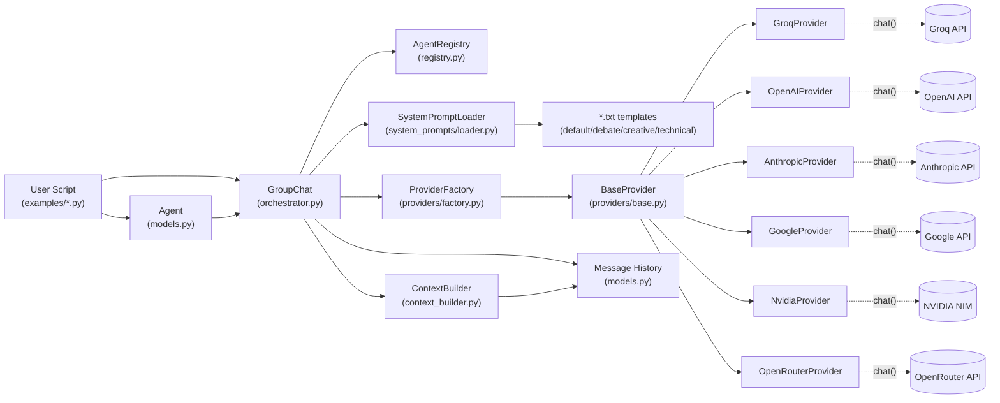

# OpenCircle Module

> **A decentralized, multi-agent group chat system where AI agents self-decide when to speak.**

Traditional multi-agent frameworks rely on a central "manager" or "router" LLM to decide which agent should speak next. **OpenCircle** flips this paradigm: all agents execute in parallel, observe the same conversation history, and independently decide whether to contribute or stay `[SILENT]`. 

---

## Table of Contents

1. [Overview & Architecture](#overview--architecture)
2. [Key Features](#key-features)
3. [Installation](#installation)
4. [Quick Start](#quick-start)
5. [Core Concepts](#core-concepts)
   - [Agents](#agents)
   - [The Orchestrator (GroupChat)](#the-orchestrator-groupchat)
   - [System Prompts](#system-prompts)
6. [Supported Providers](#supported-providers)
7. [Advanced Usage](#advanced-usage)
   - [Callbacks & Streaming (UI Integration)](#callbacks--streaming-ui-integration)
   - [Context Window Management](#context-window-management)
   - [Observability & Tracing (LangSmith)](#observability--tracing-langsmith)
8. [Project Structure](#project-structure)

---

## Overview & Architecture

OpenCircle is built on a **Parallel Single-Phase Execution** model. 

In every conversational round, the Orchestrator takes a snapshot of the canonical history and broadcasts it to all agents simultaneously. Every agent processes the context and decides to either return a message or output `[SILENT]`. If an agent (or all agents) feel the user's query is fully resolved, they can output `[DONE]` to terminate the loop.

### How it Works (Data Flow)

```text
[ User Query ] ──> Added to Canonical History (UUID-based)
                            │
        ┌───────────────────┴───────────────────┐
        │       ROUND START (Parallel)          │
        ├──────────────┬──────────────┬─────────┤
        │              │              │         │
    ┌───▼───┐      ┌───▼───┐      ┌───▼───┐     │
    │ Agent │      │ Agent │      │ Agent │ ... │
    │   A   │      │   B   │      │   C   │     │
    └───┬───┘      └───┬───┘      └───┬───┘     │
        │              │              │         │
    [SILENT]      "I agree!"      [SILENT]      │
        │              │              │         │
        └──────────────┼──────────────┘         │
                       │                        │
             Append to History ─────────────────┘
                       │
             Next Round or Exit if [DONE]
```

---

## Key Features

- **Decentralized Control**: No "Manager LLM" bottleneck. Agents act autonomously.
- **True Parallel Execution**: Fast response times. All agents are queried asynchronously via `asyncio`.
- **Provider-Agnostic**: Mix and match models from OpenAI, Anthropic, Google, Groq, NVIDIA, and OpenRouter in the same chat.
- **Canonical UUID History**: Clean internal data structure. Names are resolved at runtime via the `AgentRegistry`, preventing LLMs from getting confused by naming collisions.
- **Dynamic Context Building**: Automatically handles provider-specific quirks (e.g., Anthropic's strict user/assistant alternation requirements).

---

## Installation

Ensure you are using Python 3.9+.

```bash
# Create a virtual environment
uv venv
source .venv/bin/activate

# Install dependencies
uv pip install -r requirements.txt
```

---

## Quick Start

Here is a simple script putting two agents (Llama and Qwen) in a room to debate a topic.

> **Note:** Groq model IDs change frequently as models get deprecated. If you get a `model_not_found` / 404 error, check the current list at [console.groq.com/docs/models](https://console.groq.com/docs/models) and swap in a live model ID.

```python
import asyncio
from dotenv import load_dotenv
from opencircle_module import Agent, GroupChat

load_dotenv()

async def main():
    # 1. Define your agents
    agents = [
        Agent(
            name="Llama",
            model="openai/gpt-oss-120b",
            provider="groq",
        ),
        Agent(
            name="Qwen",
            model="qwen/qwen3.6-27b",
            provider="groq",
            max_tokens=4096,  # reasoning model — see note below
        ),
    ]
    
    # 2. Initialize the chat room
    chat = GroupChat(
        agents=agents, 
        system_prompt="debate",  # Uses src/opencircle_module/system_prompts/debate.txt
        max_rounds=3
    )
    
    # 3. Run the conversation
    print("Starting chat...")
    history = await chat.run("Should I learn Machine Learning or Backend Engineering first?")
    
    # 4. Print the human-readable transcript
    print("\n--- TRANSCRIPT ---")
    print(chat.get_transcript())

if __name__ == "__main__":
    asyncio.run(main())
```

API keys are picked up automatically from environment variables (e.g. `GROQ_API_KEY`) — you don't need to pass `api_key=` explicitly unless you're overriding per-agent.

---

## Core Concepts

### Agents
An `Agent` represents a single AI persona. You configure them with a `name`, a specific `model`, and the API `provider`. Each agent operates with independent `temperature` and `max_tokens` settings.

> **Reasoning models and `max_tokens`:** Some models (e.g. Qwen 3 / 3.6 series) emit an internal `<think>...</think>` block before producing their actual answer. If `max_tokens` is set too low, the model can get cut off mid-thought before it ever writes a real response — the agent will effectively return nothing that round. For reasoning models, set `max_tokens` generously (2048–4096+) to leave room for both the thinking and the answer.

### The Orchestrator (GroupChat)
The `GroupChat` class manages the lifecycle of the conversation. It holds the `AgentRegistry`, maintains the `history` of `Message` objects, and handles the `asyncio` loop that queries agents.

### System Prompts
System prompts dictate how agents behave in the group setting. They are stored as `.txt` files in `src/opencircle_module/system_prompts/`. 

The `SystemPromptLoader` dynamically injects variables into these text files at runtime:
- `$agent_name`: The current agent's name.
- `$other_agents`: A comma-separated list of the *other* agents in the room.

**Included Templates:**
- `default`: Basic conversational rules.
- `debate`: Instructs agents to play devil's advocate.
- `creative`: Encourages brainstorming and "yes, and..." thinking.
- `technical`: Focuses on implementation details and edge cases.

*To use your own custom prompts, create a local directory (e.g., `my_prompts/`), place a `.txt` file inside it (e.g., `creative.txt`), and initialize GroupChat with `prompts_dir="my_prompts"` and `system_prompt="creative"`.*

---

## 🔌 Supported Providers

OpenCircle abstracts the complexities of different LLM SDKs. To use a provider, simply set its environment variable and pass its string identifier to the `Agent`.

| Provider String | Required Environment Variable | Notes |
| :--- | :--- | :--- |
| `openai` | `OPENAI_API_KEY` | Standard OpenAI compatible. |
| `anthropic` | `ANTHROPIC_API_KEY` | Uses `anthropic` SDK. Extracts system prompts automatically. |
| `groq` | `GROQ_API_KEY` | Auto-strips `<think>` tags from reasoning models. Model IDs deprecate frequently — check [console.groq.com/docs/models](https://console.groq.com/docs/models) for current ones. |
| `google` | `GOOGLE_API_KEY` *(or GEMINI_API_KEY)* | Uses `google-generativeai`. Maps roles to `user`/`model`. |
| `nvidia` | `NVIDIA_API_KEY` | Uses standard OpenAI SDK pointing to NVIDIA NIM URL. |
| `openrouter` | `OPENROUTER_API_KEY` | Includes standard OpenRouter HTTP headers. |

> **Remember to call `load_dotenv()`** at the top of your script if you're storing keys in a `.env` file — it's not automatic. Forgetting this is a common cause of `"The api_key client option must be set..."` errors even when your `.env` looks correct.

---

## Advanced Usage

### Callbacks & Streaming (UI Integration)
If you are building a frontend (like a Gradio, Streamlit, or web app) and want to see messages as they are generated, you can pass callback functions to `GroupChat`:

```python
def handle_new_message(msg):
    # msg is a Message object
    print(f"[{msg.sender_id}] just spoke: {msg.content}")

def handle_round_complete(agent, response):
    if response is None or "[SILENT]" in response:
        print(f"{agent.name} was silent.")
    else:
        print(f"{agent.name} finished speaking.")

chat = GroupChat(
    agents=agents,
    on_message=handle_new_message,
    on_round_complete=handle_round_complete
)
```

`msg.sender_id` is an internal UUID, not a display name — resolve it via `chat.registry.get_name(msg.sender_id)` if you want to print the agent's name instead.

Note also that `response is None` covers two different cases: a genuine provider/API failure, and a message that reduced to nothing after `[SILENT]` was stripped. Both currently look the same from the callback's perspective — check your logs (or the exception logged internally) if you need to tell them apart.

### Context Window Management
To prevent long conversations from crashing the LLM APIs, you can limit the amount of history sent to the agents:

```python
chat = GroupChat(
    agents=agents,
    max_history_messages=10,        # Only send the last 10 messages to the LLM
    include_silent_in_history=False # Keep [SILENT] messages out of the context window
)
```


### Observability & Tracing (LangSmith)

OpenCircle has built-in support for **LangSmith** to provide deep visibility into every agent's thought process, API latency, and token usage. This allows you to debug exactly why an agent chose to speak or why it stayed silent.

Tracing is entirely **optional**. If the relevant environment variables aren't set, tracing is simply skipped and the app runs normally.

#### 1. Setup
Install the LangSmith client and set your environment variables:

```bash
uv pip install langsmith
```

```text
LANGCHAIN_TRACING_V2=true
LANGCHAIN_API_KEY=ls__your_key_here
LANGCHAIN_PROJECT=opencircle_dev
```

#### 2. Usage
Tracing is automatically enabled if the environment variables are present. You can also pass the configuration explicitly when initializing the chat:

```python
chat = GroupChat(
    agents=agents,
    langchain_api_key="ls__your_key_here", # Optional: overrides environment
    langchain_project="my_gc_project"
)
```

#### 3. What you see in the dashboard
Once enabled, every round of chat creates a structured trace:

- `agent_turn`: A high-level span showing which specific agent is attempting to respond.

- `llm_[provider]`: A detailed span showing the exact raw JSON history sent to the provider (OpenAI/Groq/etc.) and the raw text response received.

This makes it easy to spot formatting errors, token limits, or logic issues in real-time.

#### 4. If your key is invalid or expired
An invalid or unauthorized key doesn't crash the app, but LangSmith's background client will log warnings like:

```text
Failed to multipart ingest runs: langsmith.utils.LangSmithError: ... 403 Client Error: Forbidden ...
```

To fix it, generate a fresh key at [smith.langchain.com/settings](https://smith.langchain.com/settings) and confirm it matches the org/project you're tracing to. To silence the warnings without fixing the key (e.g. while tracing isn't a priority), add this near the top of your script:

```python
import logging
logging.getLogger("langsmith").setLevel(logging.CRITICAL)
```

---

## Testing & Examples

To see more complex use-cases and verify your setup, check out the included examples and tests:

- **Examples**: Browse the `examples/` directory for ready-to-run scripts.
  - `basic_chat.py`: A simple conversational debate between two agents.
  - `advanced_chat_callbacks.py`: Demonstrates how to hook into the chat lifecycle for real-time streaming and UI updates.
- **Tests**: Run `pytest tests/` from the root directory to verify that the package is installed correctly and all imports work.

---

## Project Structure

### Folder Layout

```mermaid
flowchart TD
    ROOT["opencircle_module/"]

    ROOT --> EX["examples/"]
    EX --> EX1["basic_chat.py"]
    EX --> EX2["advanced_chat_callbacks.py"]

    ROOT --> SRC["src/"]
    SRC --> PKG["opencircle_module/"]

    PKG --> PROV["providers/"]
    PROV --> P0["__init__.py"]
    PROV --> P1["base.py"]
    PROV --> P2["factory.py"]
    PROV --> P3["anthropic_provider.py"]
    PROV --> P4["google_provider.py"]
    PROV --> P5["groq_provider.py"]
    PROV --> P6["nvidia_provider.py"]
    PROV --> P7["openai_provider.py"]
    PROV --> P8["openrouter_provider.py"]

    PKG --> SP["system_prompts/"]
    SP --> SP0["__init__.py"]
    SP --> SP1["loader.py"]
    SP --> SP2["default.txt"]
    SP --> SP3["debate.txt"]
    SP --> SP4["creative.txt"]
    SP --> SP5["technical.txt"]

    PKG --> M0["__init__.py"]
    PKG --> M1["models.py"]
    PKG --> M2["registry.py"]
    PKG --> M3["context_builder.py"]
    PKG --> M4["orchestrator.py"]
    PKG --> M5["utils.py"]
    PKG --> M6["py.typed"]

    ROOT --> TESTS["tests/"]
    TESTS --> T1["test_imports.py"]

    ROOT --> CFG1["pyproject.toml"]
    ROOT --> CFG2["requirements.txt"]
    ROOT --> CFG3["uv.lock"]
    ROOT --> CFG4["Readme.md"]
```



### Module Dependency Flow

